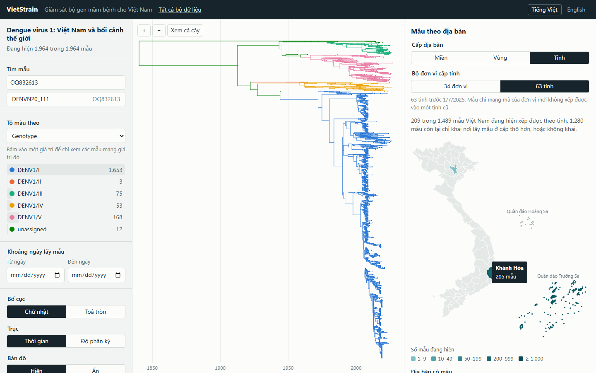
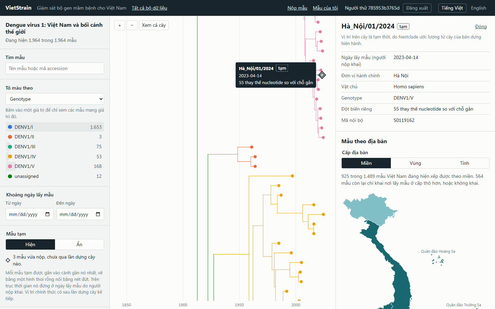
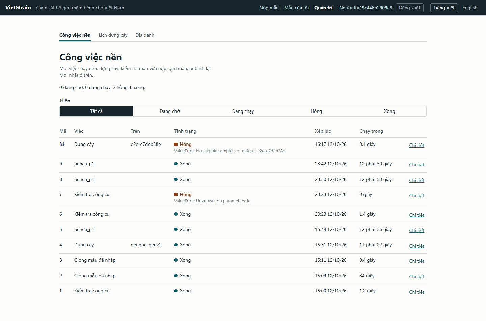

# VietStrain

Ứng dụng web giám sát bộ gen mầm bệnh cho Việt Nam. Nó có các tính năng lõi của [Nextstrain](https://nextstrain.org) (cây phát sinh loài theo thời gian, bản đồ, lọc và tô màu), nhưng được thiết kế để **vận hành liên tục**: phòng xét nghiệm nộp một chuỗi và thấy nó trên cây sau vài giây, cây được dựng lại theo lịch, và địa danh Việt Nam được chuẩn hoá tới cấp tỉnh.

Đây là sản phẩm của một đồ án tốt nghiệp ngành công nghệ thông tin. Tên "VietStrain" là tên tạm. Mầm bệnh đầu tiên là virus dengue, dùng dữ liệu công khai từ GenBank.



## Ứng dụng làm được gì

- **Xem:** danh sách bộ dữ liệu; cây vẽ bằng Canvas (bố cục chữ nhật và toả tròn, trục thời gian hoặc độ phân kỳ); tô màu, lọc theo thuộc tính và theo ngày; tìm mẫu; bản đồ theo miền, vùng, tỉnh (bộ 63 tỉnh cũ và bộ 34 đơn vị từ 1/7/2025); tiếng Việt và tiếng Anh.
- **Nộp mẫu:** người nộp đăng nhập, gửi một file FASTA kèm ngày và nơi lấy mẫu. Hệ thống tự tìm serotype, kiểm tra chất lượng, rồi gắn tạm mẫu vào cây đang phát. Mẫu thành tip chính thức ở lần dựng cây kế tiếp. Người nộp sửa được tên, ngày, tỉnh và vật chủ của mẫu mình đã nộp.
- **Vận hành:** cây được dựng lại theo lịch và chỉ khi tập mẫu đã đổi; admin theo dõi các việc nền, chạy lại việc hỏng, và gán các cách viết địa danh chưa khớp ngay trên giao diện.

| Mẫu vừa nộp, gắn tạm lên cây | Trang việc nền của admin |
|---|---|
|  |  |

## Vì sao không dùng thẳng Nextstrain

Giai đoạn đầu của đồ án đo Nextstrain trên cùng máy và tìm ra năm vấn đề khi dùng nó cho giám sát thường xuyên. Mỗi vấn đề được trả lời bằng một quyết định thiết kế, rồi đo lại trên ứng dụng này. Bảng đầy đủ, cách đo và giới hạn của từng phép đo ở [`docs/KET-QUA.md`](docs/KET-QUA.md).

| Vấn đề đo được ở Nextstrain | Cách làm ở đây | Kết quả đo lại |
|---|---|---|
| Thêm một mẫu là dựng lại cả cây: 2.020 giây ở 5.000 chuỗi | Mẫu mới được Nextclade gắn tạm vào cây có sẵn; cây được dựng lại theo lịch | 2,4 giây từ lúc nộp tới lúc mẫu hiện công khai, trên cây 4.949 tip |
| Một cách viết địa danh lạ phải sửa file rồi chạy lại cả pipeline | Địa danh gốc lưu nguyên văn trong database; sửa là thêm một dòng rồi publish lại các cột, cây giữ nguyên | 0,64 giây, so với 682 giây của một lần dựng cây |
| Auspice mất 4,4 giây để mở cây 35 nghìn tip và không mở được cây 100 nghìn tip | Cây nằm trong mảng phẳng, parse trong Web Worker, vẽ bằng Canvas có gộp chi tiết | 0,47 giây tới khung hình đầu ở 35 nghìn tip; lọc và đổi màu bận main thread nhiều nhất 40 ms; cây 100 nghìn tip mở được |
| 2% bản ghi dengue Việt Nam ra được tỉnh | Bảng đơn vị hành chính có mã và hiệu lực theo thời gian, bảng tên thay thế, cấp vùng riêng | 18,2% ra tỉnh và 53,6% ra tỉnh hoặc vùng (phần còn lại để trống ngay từ GenBank) |
| Tên mẫu có dấu làm hỏng `augur tree`; tham số chèn được lệnh | Công cụ chỉ thấy mã nội bộ; gọi bằng danh sách đối số, không qua shell | Tên `Hà_Nội/01/2024; touch pwned` đi trọn luồng nộp và dựng cây, không file nào được tạo |

Hai điều ứng dụng **không** làm tốt hơn, nói rõ để khỏi hiểu nhầm:

- **Dựng cây không nhanh hơn.** Gióng từng mẫu một lần lúc nhập bỏ được bước gióng hàng (318 giây ở 5.000 chuỗi), nhưng bước `augur refine` chạy chậm hơn trên đầu vào này và ăn hết phần đó: 2.026 giây so với 2.020 giây. Thứ giữ thời gian dựng cây trong tầm kiểm soát là trần số mẫu của mỗi bộ dữ liệu.
- **Mẫu gắn tạm chỉ là tạm.** Giấu 100 mẫu khỏi cây DENV1 rồi gắn tạm lại từng mẫu: 95 mẫu rơi cạnh đúng hàng xóm gần nhất mà chúng có trong cây dựng lại đầy đủ, 5 mẫu thì không. Vị trí chính thức chỉ có sau lần dựng cây kế tiếp, và giao diện đánh dấu mẫu tạm khác hẳn tip thường.

## Kiến trúc

```
trình duyệt ── nginx (web, cổng 8080) ─┬─ frontend đã build (React, Canvas)
                                       ├─ file của các bản publish (tên theo hash, cache vĩnh viễn)
                                       └─ /api ── FastAPI (api) ── PostgreSQL (db)
                                                                      │  bảng `job` là hàng đợi
                                          worker: dựng cây, gắn lại mẫu, xét lịch ──┤
                                          ingest: chỉ kiểm tra mẫu vừa nộp ─────────┘
```

- **PostgreSQL** là nguồn sự thật cho mẫu, chuỗi, địa danh, build và job, và kiêm luôn hàng đợi (`FOR UPDATE SKIP LOCKED`); không có Redis hay Snakemake.
- **Worker** chạy trong image dẫn xuất từ `nextstrain/base`, nên dùng đúng Augur, Nextclade và IQ-TREE đã đo. Mỗi bước của pipeline là một hàm Python ghi trạng thái, thời gian và log vào database, để giao diện thấy được tiến độ.
- **Viewer** đọc định dạng cột (một file cho cây, mỗi cột tô màu một file) thay cho Auspice JSON; bản publish vẫn kèm một file Auspice v2 để tương thích.

Lý do của từng quyết định lớn nằm trong mười ADR ở [`docs/decisions/`](docs/decisions/). Đặc tả tổng ở [`SPEC.md`](SPEC.md), đặc tả từng module ở [`specs/`](specs/), tiến độ và kết quả nghiệm thu từng mốc ở [`tasks/todo.md`](tasks/todo.md).

## Chạy trên máy

Cần: Docker (Docker Desktop trên Windows), Node.js 24 để build frontend, và khoảng 15 GB đĩa trống (các image chiếm 7 GB, phần còn lại là database và cache lúc build). Các lệnh dưới đây chạy từ thư mục gốc của repo.

**1. Bật các service** (lần đầu sẽ build hai image; image của worker kéo theo `nextstrain/base`, vài GB):

```bash
docker compose -f deploy/docker-compose.yml up -d --build
curl -s http://127.0.0.1:8000/api/health
```

Service `init` tự chạy migration và nạp dữ liệu địa danh cùng bốn bộ dữ liệu dengue (DENV1 tới DENV4).

**2. Build frontend** (nginx phát thư mục `frontend/dist`):

```bash
cd frontend
npm install
npm run build
cd ..
```

**3. Nạp dữ liệu GenBank.** Repo không chứa dữ liệu. Chạy workflow `ingest` của [nextstrain/dengue](https://github.com/nextstrain/dengue), rồi chép `ingest/results/metadata_all.tsv` và `ingest/results/sequences_all.fasta` vào `data/genbank-dengue/`.

```bash
MSYS_NO_PATHCONV=1 docker compose -f deploy/docker-compose.yml exec api \
  python -m app.cli import-genbank \
  --metadata /data/genbank-dengue/metadata_all.tsv \
  --sequences /data/genbank-dengue/sequences_all.fasta
```

`MSYS_NO_PATHCONV=1` chỉ cần trong Git Bash trên Windows.

**4. Gióng các genome và dựng cây đầu tiên.** Mỗi lệnh xếp một việc nền và in ra mã của nó:

```bash
docker compose -f deploy/docker-compose.yml exec api python -m app.cli enqueue align_pending
docker compose -f deploy/docker-compose.yml exec api python -m app.cli enqueue build_dataset --params '{"dataset": "dengue-denv1"}'
docker compose -f deploy/docker-compose.yml exec api python -m app.cli job 2   # xem việc mang mã 2 và các bước của nó
```

Gióng khoảng 22 nghìn genome mất chừng nửa phút; dựng cây DENV1 2.000 mẫu mất khoảng 11 phút trên máy 8 nhân.

**5. Tạo tài khoản quản trị đầu tiên** (mật khẩu được hỏi khi chạy):

```bash
docker compose -f deploy/docker-compose.yml exec api \
  python -m app.cli create-user --email ten@donvi.vn --name "Tên hiển thị" --role admin
```

**6. Mở** <http://127.0.0.1:8080> và đăng nhập. Từ đây không cần dòng lệnh nữa: ở trang Quản trị, admin đặt lịch dựng cây và tạo tài khoản cho các phòng xét nghiệm (tab Tài khoản; ở đó cũng khoá, mở khoá và đặt lại mật khẩu). Ai cũng tự đổi được mật khẩu của mình: bấm vào tên mình ở thanh đầu trang.

Cấu hình này dành cho một máy phát triển: mật khẩu database là mặc định, cổng chỉ mở trên `127.0.0.1`, chưa có HTTPS.

## Test

```bash
# Backend: pytest với PostgreSQL thật (database riêng cho test)
docker compose -f deploy/docker-compose.yml exec api pytest
# Cùng bộ test trong image worker: các test cần Augur, Nextclade, IQ-TREE chạy thật
docker compose -f deploy/docker-compose.yml exec worker pytest
docker compose -f deploy/docker-compose.yml exec api ruff check .

# Frontend (trong frontend/)
npm run test        # logic, vitest
npm run typecheck
npm run lint
npm run e2e         # Playwright trên stack đang chạy; cần bộ dữ liệu dengue-denv1 đã có cây
npm run e2e:web     # cùng bộ test, đi qua nginx
```

Hai lệnh pytest dùng chung một database test, nên chạy lần lượt, không chạy cùng lúc.

## Cấu trúc thư mục

```
backend/app/        mã backend, mỗi module một gói: geo, samples, jobs, build, accounts, submissions, operations
backend/migrations/ migration Alembic
backend/tests/      pytest
frontend/src/       React: tree (cây, mẫu tạm), map (bản đồ), submit (form nộp), admin, components
frontend/e2e/       test đầu-cuối
frontend/map-data/  hai file đường biên tỉnh và nguồn của chúng
deploy/             docker-compose.yml, hai Dockerfile, nginx.conf
docs/               ADR, kết quả đo, ảnh
specs/, SPEC.md     đặc tả
tasks/              kế hoạch và danh sách việc, kèm kết quả nghiệm thu từng mốc
data/               dữ liệu nạp vào và file build sinh ra; không nằm trong git
```

## Giới hạn

- Chạy trên một máy bằng Docker Compose; chưa triển khai lên server, chưa có HTTPS, chưa đo dưới tải.
- Mọi số đo dùng DENV1 và một máy (8 nhân, 13 GB cho Docker).
- Giới hạn đăng nhập theo địa chỉ IP nằm ở nginx (30 lần liền nhau, sau đó một lần mỗi 2 giây). Trên Docker Desktop mọi người dùng tới nginx với cùng một địa chỉ, nên ở máy phát triển giới hạn này là chung.
- Không có tự đăng ký và không có "quên mật khẩu" qua email (hệ thống không gửi thư): tài khoản do admin tạo, người quên mật khẩu nhờ admin đặt lại. Mật khẩu admin đặt không bị ép đổi ở lần đăng nhập đầu.
- Mỗi lần nộp một chuỗi, và chuỗi của mẫu đã nộp không sửa được (chuỗi khác là mẫu khác).
- Vùng của 34 đơn vị hành chính mới chưa có nguồn chính thức nên chưa được gán; mã đơn vị là mã nội bộ.
- Cách chọn mẫu bối cảnh thế giới cho mỗi cây là một quy tắc đơn giản; đồ án tập trung vào kiến trúc, không đánh giá chất lượng khoa học của cây.

## Dữ liệu và công cụ của bên khác

- Chuỗi và metadata dengue: GenBank (NCBI), lấy qua workflow `ingest` của Nextstrain.
- Reference, chú giải gen và định nghĩa genotype dengue: chép từ [nextstrain/dengue](https://github.com/nextstrain/dengue); nguồn của từng file ở [`backend/app/pathogens/dengue/NGUON.md`](backend/app/pathogens/dengue/NGUON.md). Repo đó không có file giấy phép; chuỗi reference là bản ghi RefSeq công khai.
- Augur, Nextclade, IQ-TREE, TreeTime: chạy nguyên bản trong image `nextstrain/base`.
- Đường biên tỉnh: OCHA COD-AB trên Humanitarian Data Exchange (34 đơn vị, CC BY-IGO) và geoBoundaries (63 tỉnh). Chi tiết, giấy phép và các thay đổi đã làm ở [`frontend/map-data/NGUON.md`](frontend/map-data/NGUON.md).
